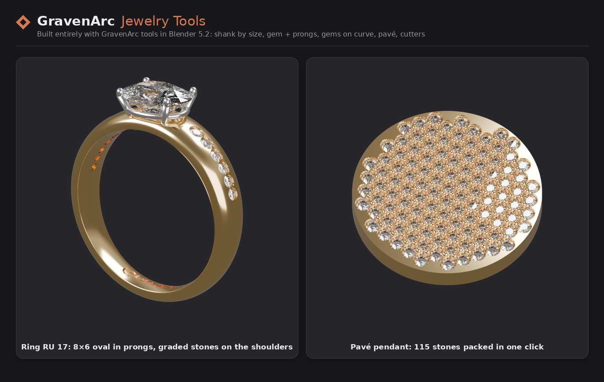

# GravenArc Toolkit 1.2.0: installing in Blender 5.2 LTS

A single file, **gravenarc_toolkit-1.2.0.zip** (≈19 MB), contains everything:
- 25 ZBrush-style "GA …" brushes;
- 3 ornament alpha brushes;
- 103 templates (rings, shanks, pendants, settings, gems, geometry, sculpting bases);
- **jewelry tools** in the spirit of Rhino/RhinoGold: 13 gem cuts, heads, cutters, pavé, gems on curve, shank by size, resize, engraving, metal weight, casting check, shrinkage, report;
- 61 jewelry assets (gems, cutters, prong heads and bezels);
- **sculpt tools** (since 1.2.0): Shift+R stroke replay, Alt+R mask last stroke, marker, separate/delete masked, Alt+Right Mouse size/hardness, Alt+L straight line, brush preset folders, smoothing. Step by step: [sculpt_tools/README_en.md](../GravenArc_Library/sculpt_tools/README_en.md).

There is **no need** to unzip it. If you previously installed the separate `gravenarc_jewelry`, disable and remove it: everything is already inside.

> The add-on interface is in Russian. The English guides give each button in Russian with a translation.

## Installation (either way)

**Way 1: drag and drop**
1. Open Blender 5.2.
2. Drag `gravenarc_toolkit-1.2.0.zip` from the folder straight into the Blender window (onto the 3D Viewport).
3. Press **OK / Install** in the dialog. Done: the extension is already enabled.

**Way 2: through Preferences**
1. **Edit → Preferences** (or `Ctrl+,`).
2. **Get Extensions** on the left.
3. The **⌄** arrow at the top right → **Install from Disk…**
4. Choose `gravenarc_toolkit-1.2.0.zip` → **Install from Disk**.
5. Make sure "GravenArc Toolkit" is ticked in the **Add-ons** list.

> If Preferences are not saved automatically: ☰ menu bottom left → **Save Preferences**.

## What happens when it is enabled

- A **GravenArc** library (a folder inside the extension) appears in **Edit → Preferences → File Paths → Asset Libraries**. Nothing has to be set up by hand.
- Panels appear in the 3D Viewport under **N › GravenArc**: **GravenArc Toolkit** (library) and **Ювелирка** (Jewelry tools); in Sculpt Mode also **Sculpt: Repeat & Mask**, **Sculpt: Photoshop Brush** and **Sculpt: Brush Presets**.
- The jewelry pie menu **Shift+Alt+J** (Object Mode) is enabled.
- When the extension is disabled or removed, the library is removed automatically.

## Where to find things

| What | Where |
|---|---|
| Panels | 3D Viewport → `N` → **GravenArc** tab |
| Brushes and alphas | Sculpt Mode (`Ctrl+Tab`) → asset shelf at the bottom of the viewport; quick search `Shift+Space` |
| Templates and jewelry assets | Asset Browser (`Shift+F1` or the "Открыть Asset Browser" (Open Asset Browser) button) → **GravenArc** library → drag into the viewport |
| Jewelry tools | **Ювелирка** panel, **Shift+Alt+J** pie menu, **Shift+A** menu (Gem, Shank by size) |

## GravenArc Toolkit panel buttons

- **Подключить библиотеку заново** (Reconnect library): if the File Paths entry was deleted by accident.
- **Открыть Asset Browser** (Open Asset Browser): opens the GravenArc library (in a separate window if there is no Asset Browser on screen).
- **Сцена в миллиметрах** (Scene in millimetres): Metric, Unit Scale 0.001, Millimeters: 1 unit = 1 mm. Press it in every new file before you start.
- **Подсказки** (Tips): guides for brushes, alphas, templates and jewelry; the **EN** button next to each opens the English version.

## Extension settings

Preferences → Add-ons → GravenArc Toolkit → arrow: **Импорт ассетов** (Asset import): *Append* (a copy in your file, default), *Link* or *Pack*.

## Updating

Install the new .zip the same way: the old version is replaced and the library is reconnected.

## For developers

- Extension source: `src/gravenarc_toolkit/` (`__init__.py`, `blender_manifest.toml`, `LICENSE` GPL-3.0-or-later).
- Jewelry tools code: `../GravenArc_Library/jewelry_tools/gravenarc_jewelry/`; the build puts it into `modules/jewelry/` and its assets into `library/jewelry/`.
- Sculpt module: `src/gravenarc_toolkit/modules/sculpt/`; tests: `BLENDER_USER_RESOURCES=$(mktemp -d) python tests/test_sculpt.py dist/gravenarc_toolkit-1.2.0.zip` (needs `pip install bpy==5.2.4`).
- Build: `bash build_addon.sh` (needs `blender` 5.2+ in PATH or `BLENDER=/path/to/blender`). The script takes the assets from `../GravenArc_Library/`, runs `blender --command extension validate` and `build`, and puts the .zip into `dist/`.
- Previews and showcase sheets (Cycles studio renders, in `GravenArc_Library/tools/`):
  - `make_brushes.py` → brushes + volumetric icons (`brush_icons.py`, a red-wax sphere with the real stroke);
  - `alpha_icons.py` → alpha previews as a silver relief stamp;
  - `render_previews.py -- templates jewelry` → template and jewelry asset previews (18K gold, silver, diamond, wax) and the `preview_sheet.png`, `jewelry_preview.png` sheets;
  - `render_demo.py` → `jewelry_tools/demo/demo_render.png`;
  - `showcase_sheet.py` → branded labelled sheet (plain Python 3 + Pillow).
  Run with `blender -b --factory-startup --python <script>.py`.
