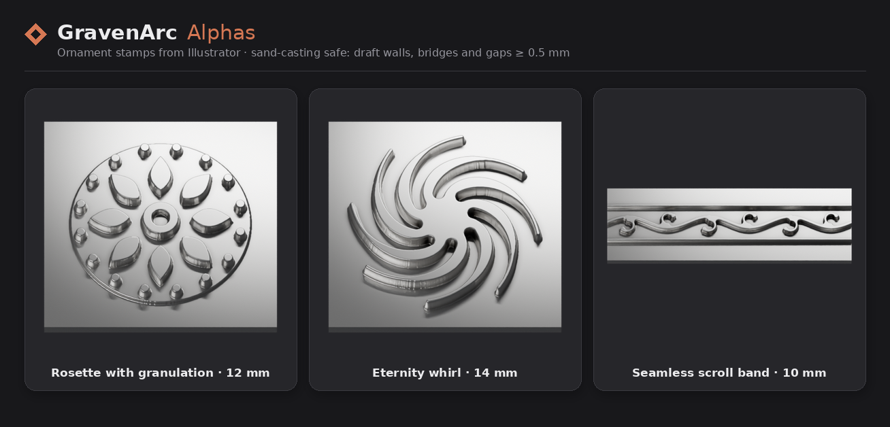

# GravenArc · Alpha-кисти из орнаментов Illustrator




Пайплайн: **вектор в Illustrator → SVG → карта высот (16-bit PNG) → кисть-ассет Blender 5.2 LTS**.
Все размеры в миллиметрах. Рельеф сразу строится под литьё в песок: стенки с уклоном, без поднутрений, проверка перемычек и щелей ≥ 0,5 мм.

```
alphas/
├─ src/                    исходные SVG (ваши орнаменты кладите сюда)
│   ├─ jewel_rosette.svg       розетка с зернью, 12 мм (3 уровня высоты)
│   ├─ arevakhach_whirl.svg    вихрь вечности, 8 лучей, 14 мм
│   └─ band_scroll_tile.svg    бесшовный бордюр-завиток для шинки, 10 × 5,6 мм
├─ maps/                   результат svg2alpha.py
│   ├─ *.png               карта высот, 16 bit, чёрный = 0, белый = полная высота
│   ├─ *_check.png         проверка: красное = тонкая перемычка, синее = узкая щель
│   ├─ *_preview.png       превью для кисти (серебряный оттиск, tools/alpha_icons.py)
│   ├─ *_render.png        крупный рендер оттиска 512 px
│   └─ *.json              размер в мм, глубина, уклон, итог проверки
├─ tools/
│   ├─ svg2alpha.py        конвертер SVG/PNG → карта высот
│   ├─ make_alpha_brushes.py   карты → кисти-ассеты (запуск в Blender)
│   └─ requirements.txt
├─ build_demo.sh           пересобрать демо-альфы
└─ GravenArc_Alphas.blend  готовые кисти (текстуры упакованы внутрь)
```

Каталоги в библиотеке ассетов: `GravenArc/Alphas/Jewelry`, `GravenArc/Alphas/Armenian`, `GravenArc/Alphas/Bands` (файл `blender_assets.cats.txt` общий, в корне `GravenArc_Library/`).

---

## 1. Подготовка орнамента в Illustrator

1. **Документ в мм:** `Ctrl+Alt+P` (Document Setup) → Units: Millimeters.
2. Рисуйте в реальном размере: розетка 12 мм должна быть 12 мм на монтажной области.
3. **Высота = цвет заливки:**
   * чёрный (K 100%) — полная высота рельефа;
   * серый K 75% / 50% / 25% — ступени 75 / 50 / 25 % высоты (так сделан фон розетки);
   * белый или пусто — ноль.
4. Обводки можно оставить — скрипт их понимает. Надёжнее перевести в заливку: `Object → Path → Outline Stroke`.
5. Помните про песок: **ширина линии ≥ 0,5 мм, щель между элементами ≥ 0,5 мм**.
6. Монтажная область по рисунку: `Object → Artboards → Fit to Artwork Bounds`.
7. Экспорт: `File → Export → Export As…` → формат **SVG** (Use Artboards — включить):
   * Styling: Presentation Attributes, Decimal: 3;
   * **Responsive — выключить** (тогда в файле останутся размеры в мм).
8. Положите SVG в `alphas/src/`.

> Если в Illustrator рисунок сделан не в масштабе — не страшно, задайте размер ключом `--size-mm`.

## 2. Установка конвертера (один раз)

Нужен Python 3.10+.

```bash
cd GravenArc_Library/alphas/tools
pip install -r requirements.txt
```

На Windows `cairosvg` иногда не находит библиотеку Cairo. Тогда либо установите Inkscape (скрипт сам его найдёт), либо экспортируйте из Illustrator PNG (чёрное на прозрачном, 1000+ px) и подайте PNG с `--size-mm`.

## 3. Конвертация

```bash
cd GravenArc_Library/alphas
python tools/svg2alpha.py src/мой_орнамент.svg --depth-mm 0.4 --draft-deg 15
```

Скрипт напишет `OK` или `!!`. При `!!` откройте `maps/*_check.png`: красное — перемычка тоньше 0,5 мм, синее — щель уже 0,5 мм (или острый внутренний угол).

Основные ключи:

| Ключ | По умолчанию | Что делает |
|---|---|---|
| `--size-mm 12` | из SVG | большая сторона рисунка = 12 мм |
| `--depth-mm 0.4` | 0.4 | высота рельефа, мм |
| `--draft-deg 15` | 15 | уклон стенок от вертикали, ° (для песка не меньше 5–7°) |
| `--profile round` | round | `flat` фаска, `round` скруглённое плечо, `dome` «подушка» |
| `--tile x` | нет | бесшовность по горизонтали (бордюры на шинку) |
| `--fix-gaps` | выкл | заливает щели < 0,5 мм и скругляет острые внутренние углы |
| `--min-bridge 0.5` / `--min-gap 0.5` | 0.5 | пороги проверки, мм |
| `--ppmm 40` | 40 | разрешение: 40 пикс/мм = 25 мкм (для Halot R6 с запасом) |
| `--catalog GravenArc/Alphas/Armenian` | GravenArc/Alphas | каталог кисти в Blender |
| `--title "Название"` | имя файла | название кисти |

Почему нет поднутрений: карта высот — это одна высота на точку, нависаний в ней не бывает. А уклон гарантирован тем, что стенка строится по расстоянию от контура: ширина фаски = высота × tg(уклона), то есть 0,4 мм при 15° дают фаску ≈ 0,11 мм (для `round` ≈ 0,17 мм).

Демо пересобирается так: `sh build_demo.sh`.

## 4. Сборка кистей в Blender

**Вариант А — из консоли (быстро, без интерфейса):**

```bash
blender -b --factory-startup --python GravenArc_Library/alphas/tools/make_alpha_brushes.py
```

**Вариант Б — из Blender:**

1. Вкладка **Scripting** (вверху) → в текстовом редакторе `Alt+O` (Open) → `alphas/tools/make_alpha_brushes.py`.
2. `Alt+P` — Run Script.

Скрипт создаёт/обновляет `alphas/GravenArc_Alphas.blend`: по кисти на каждую карту из `maps/`, текстуры упакованы, кисти помечены как ассеты и разложены по каталогам. Повторный запуск обновляет кисти, каталоги только дописываются.

Как настроены кисти:
* Draw, текстура в режиме **Area Plane**, спад **Constant** (форму даёт сама альфа);
* **размер в мм сцены** (Radius Unit: Scene) = реальный размер орнамента;
* штампы (розетка, вихрь): Stroke **Drag Dot**;
* бордюр: Stroke **Space**, шаг 100 %, **Rake** (узор поворачивается по ходу штриха).

## 5. Подключение библиотеки (один раз)

1. `Edit → Preferences` → **File Paths** → **Asset Libraries** → `+`.
2. Укажите папку `GravenArc_Library` (корень, где лежит `blender_assets.cats.txt`). Имя: `GravenArc`. Import Method: **Append (Reuse Data)**.
3. Сохраните настройки (кнопка ☰ слева внизу → Save Preferences).

## 6. Сцена в миллиметрах

`Properties` → вкладка **Scene** → **Units**: Unit System **Metric**, Unit Scale **0.001**, Length **Millimeters**. Теперь 1 единица = 1 мм, и кисть «Розетка 13,9 мм» в сцене тоже 13,9 мм.

## 7. Штамповка

1. Выделите модель → `Ctrl+Tab` (пай-меню режимов) → **Sculpt Mode**.
2. Плотность сетки должна держать деталь 0,05 мм:
   * Voxel Remesh: `R` — задать размер вокселя мышью (или в шапке Remesh → Voxel Size **0.02–0.03 mm**), `Ctrl+R` — пересчитать; или
   * Multires: `Ctrl+2`…`Ctrl+4` для подразделения.
3. Кисть: полка ассетов внизу вьюпорта (или `Shift+Space`) → библиотека **GravenArc** → **Alphas** → кисть «GA Alpha · …».
4. Штамп (Drag Dot): зажмите ЛКМ, подведите на место, отпустите.
   * `Ctrl+F` + движение мыши — повернуть альфу (угол текстуры);
   * `F` — размер (лучше не трогать: размер уже в мм; точное число — в панели Tool, Radius);
   * `Shift+F` — сила; `Ctrl` при штамповке — вдавить вместо выдавить (гравировка);
   * `Ctrl+Z` — отменить.
5. Бордюр: ведите штрих вдоль шинки. Для идеально ровной ленты в панели Tool → Stroke → Stroke Method поставьте **Line** и тяните от точки к точке (`Alt` при этом фиксирует угол).
6. Глубина у кисти Draw не задаётся в мм напрямую — подберите силу (`Shift+F`) на пробнике и проверьте инструментом **Measure** (панель инструментов, `T`). Для точной глубины — способ ниже.

### Точная глубина в мм (через модификатор)

Когда нужна глубина «ровно 0,4 мм» (пластина, вставка кулона):

1. Плоскость/основа с UV-развёрткой, подразделённая (Subdivision Surface, Simple, уровень 7–8 или Multires).
2. **Properties → Modifiers → Add Modifier → Deform → Displace**.
3. Texture: `GA_<имя>` (уже есть в файле с кистями), Coordinates: **UV**, Midlevel **0**, Strength = **глубина в мм** (например 0.4).
4. Проверено: для розетки 13,9 мм при Strength 0.4 максимальная высота ровно 0,400 мм.
5. Навести мышь на модификатор и `Ctrl+A` — применить.

## 8. Литьё в песок: на что смотреть

* Уклон из альфы работает, когда штамп стоит перпендикулярно направлению съёма формы. На боковинах кольца стенки рельефа «наклоняются» вместе с поверхностью — там берите `--draft-deg 20–25`.
* Усадку 1,5–2 % закладывайте **на всю модель** перед экспортом (`S` → `1.017` → `Enter`), не в альфу.
* Мелкие ступени (< 0,1 мм) песок Delft clay может не взять — держите шаг уровней от 0,1 мм.
* `--fix-gaps` скругляет острые внутренние углы галтелью R 0,25 мм — песок их не держит, а металл туда не дольётся.

## 9. Лицензия

Код и демо-орнаменты — GPL-3.0-or-later (совместимо с extensions.blender.org). Демо-орнаменты нарисованы процедурно для этого набора; «вихрь вечности» — авторская трактовка традиционного армянского символа.
