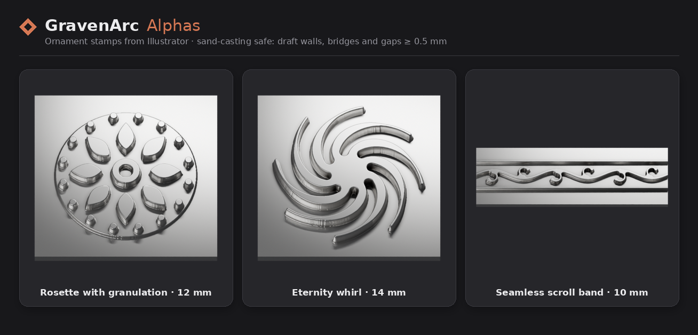

# GravenArc · Alpha brushes from Illustrator ornaments




Pipeline: **Illustrator vector → SVG → height map (16-bit PNG) → Blender 5.2 LTS brush asset**.
All sizes are in millimetres. The relief is built for sand casting from the start: sloped walls, no undercuts, a check of bridges and gaps ≥ 0.5 mm.

```
alphas/
├─ src/                    source SVGs (put your ornaments here)
│   ├─ jewel_rosette.svg       rosette with granulation, 12 mm (3 height levels)
│   ├─ arevakhach_whirl.svg    eternity whirl, 8 rays, 14 mm
│   └─ band_scroll_tile.svg    seamless scroll border for a shank, 10 × 5.6 mm
├─ maps/                   output of svg2alpha.py
│   ├─ *.png               height map, 16 bit, black = 0, white = full height
│   ├─ *_check.png         check: red = thin bridge, blue = narrow gap
│   ├─ *_preview.png       brush preview (silver stamp, tools/alpha_icons.py)
│   ├─ *_render.png        large 512 px render of the stamp
│   └─ *.json              size in mm, depth, draft, check result
├─ tools/
│   ├─ svg2alpha.py        SVG/PNG → height map converter
│   ├─ make_alpha_brushes.py   maps → brush assets (run inside Blender)
│   └─ requirements.txt
├─ build_demo.sh           rebuild the demo alphas
└─ GravenArc_Alphas.blend  ready brushes (textures packed inside)
```

Asset library catalogs: `GravenArc/Alphas/Jewelry`, `GravenArc/Alphas/Armenian`, `GravenArc/Alphas/Bands` (the shared `blender_assets.cats.txt` is in the `GravenArc_Library/` root).

---

## 1. Preparing the ornament in Illustrator

1. **Document in mm:** `Ctrl+Alt+P` (Document Setup) → Units: Millimeters.
2. Draw at real size: a 12 mm rosette must be 12 mm on the artboard.
3. **Height = fill colour:**
   * black (K 100%): full relief height;
   * grey K 75% / 50% / 25%: steps at 75 / 50 / 25 % of the height (the rosette background is made this way);
   * white or empty: zero.
4. Strokes may stay: the script understands them. Converting them to fills is safer: `Object → Path → Outline Stroke`.
5. Keep sand in mind: **line width ≥ 0.5 mm, gap between elements ≥ 0.5 mm**.
6. Fit the artboard to the artwork: `Object → Artboards → Fit to Artwork Bounds`.
7. Export: `File → Export → Export As…` → **SVG** format (Use Artboards on):
   * Styling: Presentation Attributes, Decimal: 3;
   * **Responsive off** (so the file keeps its mm dimensions).
8. Put the SVG into `alphas/src/`.

> If the drawing is not to scale in Illustrator, that is fine: set the size with `--size-mm`.

## 2. Installing the converter (once)

Requires Python 3.10+.

```bash
cd GravenArc_Library/alphas/tools
pip install -r requirements.txt
```

On Windows `cairosvg` sometimes cannot find the Cairo library. In that case either install Inkscape (the script finds it automatically) or export a PNG from Illustrator (black on transparent, 1000+ px) and pass the PNG with `--size-mm`.

## 3. Conversion

```bash
cd GravenArc_Library/alphas
python tools/svg2alpha.py src/my_ornament.svg --depth-mm 0.4 --draft-deg 15
```

The script prints `OK` or `!!`. On `!!` open `maps/*_check.png`: red = a bridge thinner than 0.5 mm, blue = a gap narrower than 0.5 mm (or a sharp inner corner).

Main options:

| Option | Default | What it does |
|---|---|---|
| `--size-mm 12` | from SVG | the longer side of the drawing = 12 mm |
| `--depth-mm 0.4` | 0.4 | relief height, mm |
| `--draft-deg 15` | 15 | wall slope from vertical, ° (at least 5–7° for sand) |
| `--profile round` | round | `flat` chamfer, `round` rounded shoulder, `dome` "cushion" |
| `--tile x` | none | seamless horizontally (borders for a shank) |
| `--fix-gaps` | off | fills gaps < 0.5 mm and rounds sharp inner corners |
| `--min-bridge 0.5` / `--min-gap 0.5` | 0.5 | check thresholds, mm |
| `--ppmm 40` | 40 | resolution: 40 px/mm = 25 µm (plenty for the Halot R6) |
| `--catalog GravenArc/Alphas/Armenian` | GravenArc/Alphas | brush catalog in Blender |
| `--title "Name"` | file name | brush name |

Why there are no undercuts: a height map has a single height per point, so it cannot contain overhangs. The draft is guaranteed because the wall is built from the distance to the outline: chamfer width = height × tan(draft), so 0.4 mm at 15° gives a chamfer of ≈ 0.11 mm (≈ 0.17 mm for `round`).

Rebuild the demo with: `sh build_demo.sh`.

## 4. Building the brushes in Blender

**Option A: from the command line (fast, no UI):**

```bash
blender -b --factory-startup --python GravenArc_Library/alphas/tools/make_alpha_brushes.py
```

**Option B: from Blender:**

1. **Scripting** tab (top) → in the Text Editor press `Alt+O` (Open) → `alphas/tools/make_alpha_brushes.py`.
2. `Alt+P`: Run Script.

The script creates/updates `alphas/GravenArc_Alphas.blend`: one brush per map in `maps/`, textures packed, brushes marked as assets and sorted into catalogs. Running it again updates the brushes; catalogs are only appended.

How the brushes are set up:
* Draw, texture in **Area Plane** mode, **Constant** falloff (the alpha itself gives the shape);
* **size in scene mm** (Radius Unit: Scene) = the real size of the ornament;
* stamps (rosette, whirl): Stroke **Drag Dot**;
* border: Stroke **Space**, spacing 100 %, **Rake** (the pattern turns along the stroke).

## 5. Connecting the library (once)

> If you installed the **GravenArc Toolkit** add-on, this is already done.

1. `Edit → Preferences` → **File Paths** → **Asset Libraries** → `+`.
2. Choose the `GravenArc_Library` folder (the root that holds `blender_assets.cats.txt`). Name: `GravenArc`. Import Method: **Append (Reuse Data)**.
3. Save Preferences (☰ button bottom left → Save Preferences).

## 6. Scene in millimetres

`Properties` → **Scene** tab → **Units**: Unit System **Metric**, Unit Scale **0.001**, Length **Millimeters**. Now 1 unit = 1 mm, and the "Rosette 13.9 mm" brush is 13.9 mm in the scene too.

## 7. Stamping

1. Select the model → `Ctrl+Tab` (mode pie menu) → **Sculpt Mode**.
2. The mesh density must hold 0.05 mm detail:
   * Voxel Remesh: `R` to set the voxel size with the mouse (or in the header Remesh → Voxel Size **0.02–0.03 mm**), `Ctrl+R` to remesh; or
   * Multires: `Ctrl+2`…`Ctrl+4` to subdivide.
3. Brush: asset shelf at the bottom of the viewport (or `Shift+Space`) → **GravenArc** library → **Alphas** → a "GA Alpha · …" brush.
4. Stamp (Drag Dot): hold LMB, move to the spot, release.
   * `Ctrl+F` + mouse move rotates the alpha (texture angle);
   * `F` sets the size (better leave it: the size is already in mm; the exact number is in the Tool panel, Radius);
   * `Shift+F` sets strength; `Ctrl` while stamping pushes in instead of out (engraving);
   * `Ctrl+Z` undoes.
5. Border: drag the stroke along the shank. For a perfectly straight band set Tool panel → Stroke → Stroke Method to **Line** and drag point to point (`Alt` locks the angle).
6. The Draw brush has no depth setting in mm: tune the strength (`Shift+F`) on a test piece and check with the **Measure** tool (toolbar, `T`). For exact depth use the method below.

### Exact depth in mm (with a modifier)

When you need a depth of "exactly 0.4 mm" (plate, pendant insert):

1. A UV-unwrapped, subdivided plane/base (Subdivision Surface, Simple, level 7–8, or Multires).
2. **Properties → Modifiers → Add Modifier → Deform → Displace**.
3. Texture: `GA_<name>` (already in the brush file), Coordinates: **UV**, Midlevel **0**, Strength = **depth in mm** (e.g. 0.4).
4. Verified: for the 13.9 mm rosette at Strength 0.4 the maximum height is exactly 0.400 mm.
5. Hover over the modifier and press `Ctrl+A` to apply it.

To bend a flat relief band around a ring, use **Обернуть вокруг кольца** (Wrap around ring) from the jewelry tools.

## 8. Sand casting: what to watch

* The draft from the alpha works when the stamp faces the mould pull direction. On the sides of a ring the relief walls "tilt" with the surface; use `--draft-deg 20–25` there.
* Add the 1.5–2 % shrinkage **to the whole model** before export (`S` → `1.017` → `Enter`), not to the alpha.
* Delft clay sand may not take tiny steps (< 0.1 mm); keep height levels at least 0.1 mm apart.
* `--fix-gaps` rounds sharp inner corners with an R 0.25 mm fillet: sand cannot hold them, and metal will not fill them.

## 9. License

Code and demo ornaments: GPL-3.0-or-later (compatible with extensions.blender.org). The demo ornaments were drawn procedurally for this kit; the "eternity whirl" is an original interpretation of the traditional Armenian symbol.
