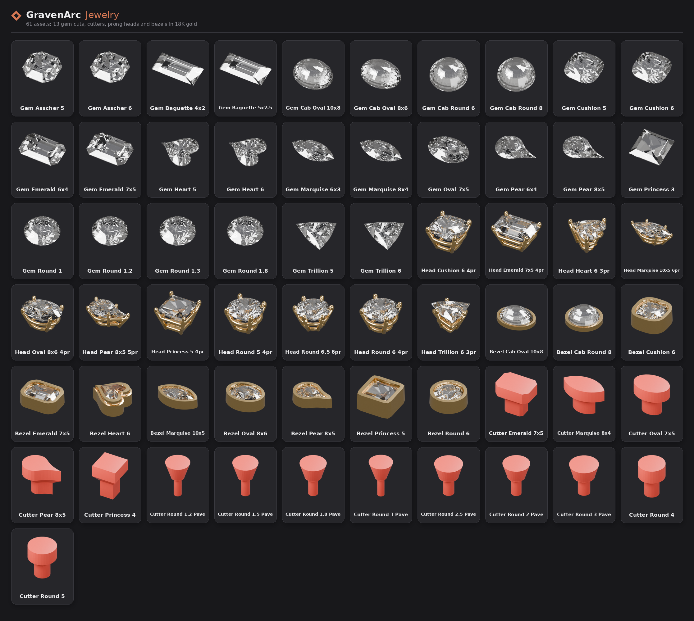

# GravenArc Jewelry Tools: Rhino/RhinoGold-style jewelry tools for Blender 5.2 LTS

An add-on plus the `GravenArc › Jewelry` asset library. It is the basis for the future GravenArc add-on
on extensions.blender.org (GPL-3.0). Everything is in millimetres. Tested in Blender 5.2.4 LTS.

> The add-on interface is in Russian. In this guide each button is given in Russian with an English translation, for example **Камень** (Gem).

## Features and their Rhino/RhinoGold equivalents

| Rhino / RhinoGold / Matrix | GravenArc (N › GravenArc) | What it does |
|---|---|---|
| Gem Studio, Gem on Surface | **Камень** (Gem) | 13 cuts: round brilliant, oval, pear, marquise, heart, cushion, trillion, princess, emerald, asscher, baguette, round and oval cabochons. Places the gem at the 3D cursor, normal to the surface, and calculates carats |
| Gem Cutter | **Вырезы под камни** (Gem cutters) | Girdle seat (+clearance), pavilion cone, through hole. Boolean into the metal in one click |
| Prong / Head Studio | **Касты → Крапаны** (Heads → Prongs) | Crown with 3–12 ball-tipped prongs, galleries, tapering base; prong layout follows the cut (pear gets a prong on the tip, etc.) |
| Bezel | **Касты → Глухая** (Heads → Bezel) | Wall following any cut, seat ledge, 2° casting draft |
| Pave | **Паве** (Pavé) | Dense, near-hexagonal packing on any surface or on selected faces, edge margin, beads between stones, flared cutters |
| Gems by Curve | **Камни по кривой** (Gems on curve) | Spacing with gap, graduated sizes (start→end or towards the centre), normal to a surface, shared prongs, cutters |
| ArrayPolar | **Полярный массив** (Polar array) | Copies around the 3D cursor (linked or independent) |
| Ring Wizard, Ring Size | **Шинка по размеру** (Shank by size) | Any size RU/EU/US/UK, 5 profiles, top/bottom width and thickness, casting draft |
| Ring Resize | **Изменить размер кольца** (Resize ring) | Radial offset: width and thickness are kept; heads and gems move with the ring |
| Analyze › Ring size | **Измерить размер** (Measure size) | Inner diameter at the narrowest point in all size systems |
| Flow Along Surface, Bend | **Обернуть вокруг кольца** (Wrap around ring) | Flat ornament/alpha relief → outside or inside the ring without stretching |
| Engrave / Text on ring | **Гравировка текстом** (Text engraving) | Cut or relief inside/outside a ring or on a plane. Any font (including Armenian) |
| Weight / Volume | **Вес металла** (Metal weight) | Volume including modifiers, weight in 14 alloys, resin in ml |
| Draft Angle Analysis, Thickness | **Проверка для литья** (Casting check) | Colours faces: undercuts, low draft, thin walls |
| Scale (shrinkage) | **Усадка** (Shrinkage) | ×1/(1−s), protected against applying twice |
| BooleanUnion | **Слить в монолит** (Make solid) | Prongs + galleries + beads → one closed shell (for weight and printing) |
| Report | **Отчёт** (Report) | Table of gems (cut, size, count, ct) and metal; CSV next to the .blend |

## Installation (step by step)

1. **Add-on.** The jewelry tools are part of the **GravenArc Toolkit** add-on: install `gravenarc_toolkit-1.1.5.zip`
   (Edit › Preferences (**Ctrl+,**) › Get Extensions › ⌄ arrow at the top right › **Install from Disk…**). Details: `GravenArc_Addon/README_en.md`.
2. **Assets.** The `GravenArc` library with the `GravenArc › Jewelry › …` catalogs is connected automatically.
3. **Scene.** In the 3D Viewport press **N** → **GravenArc** tab → **Сцена в миллиметрах** (Scene in millimetres: 1 unit = 1 mm).
   Save it as your startup file: File › Defaults › Save Startup File.

## Hotkeys

| Keys | Action |
|---|---|
| **Shift+Alt+J** (Object Mode) | Pie menu: ← Gem, → Weight, ↓ Casting check, ↑ Shank, ↖ Pavé, ↗ Gems on curve, ↙ Heads, ↘ Engraving |
| **N** | GravenArc panel |
| **F9** | Right after any operation: change its parameters (gem size, prong count, gap…) |
| **Shift+A** | At the end of the Add menu: Gem and Shank by size |
| **Shift+RMB** | Put the 3D cursor on a surface (where the gem will go) |
| **Shift+F1** | Asset Browser (ready-made gems, cutters, heads) |

## Recipes

### 1. Ring with a centre stone
1. **Shift+Alt+J → ↑ Shank**. In **F9**: system RU, size 17, profile «Комфорт» (Comfort), top width 5, bottom 2.6.
   The ring axis is Z, the top is +Y (same as the templates).
2. **Shift+RMB** on the top of the shank puts the cursor on the surface.
3. With the shank selected (active): **Shift+Alt+J → ← Gem**. In **F9**: cut «Овал» (Oval), width 6, length 8,
   «Рундист над поверхностью» (Girdle above surface) 1.5, «Каста: Крапаны» (Head: Prongs), cutter ✓.
4. With the gem selected: «Камни и касты» (Gems and heads) panel → **Крапаны** (Prongs) → in **F9** set the prong count, diameter (≥ 0.7 mm for sand casting) and galleries.
5. Cut the seat: select the gem, **Shift+click** the shank (it becomes active) → **Вырезы под камни** (Gem cutters), Boolean ✓.

### 2. Stones along the shoulders
1. Draw a curve over the ring surface (Shift+A › Curve, or select an edge loop and **F3 → Convert to Curve**).
2. Select the **shank**, then **Shift+click the curve** (the curve is active).
3. **Камни по кривой** (Gems on curve): Ø 1.6, «Ø в центре/в конце» (Ø at centre/end) 1.2, graduation «От начала к концу» (Start to end), gap 0.15,
   normal «Выделенная поверхность» (Selected surface), «Рундист над поверхностью» (Girdle above surface) −0.32, so the table sits slightly below the metal.
4. Cutters go to the **GV Cutters** collection. To apply the Boolean, make the shank active and run «Вырезы под камни» (Gem cutters), or add it by hand:
   Add Modifier › Boolean › Collection › GV Cutters.

### 3. Pavé
1. Select the surface, press **Tab**, select the faces for pavé (**3** for face mode), press **Tab** again.
2. **Паве** (Pavé, ↖ in the pie menu): Ø 1.3, gap 0.15–0.2, «Только выделенные грани» (Only selected faces) ✓. «Вариант раскладки» (Layout variant) in **F9**
   tries other layouts; pick the one with the most stones.
3. Beads (corners) are created between triplets of stones: Ø ≥ 0.6 mm for sand casting.

### 4. Engraving and ornament on a ring
* **Гравировка текстом** (Text engraving) → «Внутри кольца» (Inside ring), position 180° (bottom), height 1.4, depth 0.3. The text is mirrored so
  it reads from the inside. Any font works: leave «Шрифт» (Font) empty for Blender's built-in font, or pick any .ttf/.otf.
  For Armenian letters pick a font that has them (e.g. Noto Sans Armenian, Arial Unicode): Blender's built-in font may not include Armenian.
* **Обернуть вокруг кольца** (Wrap around ring): lay a flat ornament (for example a border from `alphas/` converted to a mesh) in the XY plane,
  select it, **Shift+click** the ring → run the operator. The length along X is preserved on the surface radius.

### 5. Before printing and casting (Delft clay)
1. **Слить в монолит** (Make solid) for heads and pavé: several intersecting pieces become one shell.
2. **Проверка для литья** (Casting check): red = undercut, yellow = draft < 2°, blue = wall < 0.5 mm. Problem faces
   are already selected: press **Tab** to see them. The eye button next to it restores normal shading.
   The parting plane is taken from `gv_parting_z_mm` (shanks and templates have it), otherwise the middle of the height.
   «Одна сторона» (One side) mode is for models with a flat back on the parting plane.
3. **Вес металла** (Metal weight): volume including Booleans, weight in every alloy, resin in ml.
4. **Усадка** (Shrinkage) 1.5–2 % (default 1.75 → ×1.0178) makes a copy «_Print+1.75%» and hides the original.
5. **Отчёт** (Report): gems and metal table (text `GV_Report` in the Text Editor, plus a CSV next to the .blend).

## Sand casting: what to keep in mind
* **Prong crowns with galleries** almost always give undercuts in a two-part mould (the check will show it).
  For sand: a bezel (built with 2° draft), a crown without galleries (`Галерей` (Galleries) = 0), or a separately made head soldered on.
* **Small through holes** under stones (Ø < 1 mm) do not hold well in sand. For casting make cutters with
  «Глубина отверстия» (Hole depth) = 0 and «Отверстие» (Hole) = 0, then drill/burr the seats afterwards using the marks.
* **Beads and prongs**: no thinner than 0.6–0.7 mm; the operator warns if thinner.
* **Engraving** shallower than 0.3 mm will not fill in sand: do it with the MOPA laser after casting.

## Assets (Asset Browser › GravenArc › Jewelry)
* **Gems**: 26 stones: pavé melee (round brilliant 1.0/1.2/1.3/1.8), oval 7×5, princess 3, pears, marquises, hearts, cushions,
  trillions, emeralds, asschers, baguettes, cabochons. Round 1.5–10, ovals and princesses 4–6 are in Templates › Gems.
* **Cutters**: 14 cutters: round brilliant 1.0–3.0 with 20° flare (pavé), 4–5 mm, oval, pear, marquise, emerald, princess.
* **Heads**: 11 prong heads; **Bezels**: 10 bezels. These are "gem + metal + cutter" collections.
  After dragging one in, untick "Instance" in **F9** to get editable objects.
* Gems from the assets work with all tools (cutters, heads, report) through the properties `gv_gem`, `gv_gem_L`, `gv_gem_W`.

## Files
* `gravenarc_jewelry/`: add-on source code (`core` units, sizes and densities; `gems` cuts, cutters, heads;
  `ring` shank, resize, wrap, text; `layout` pavé and curves; `analysis` weight and checks; `ops`, `ui`).
* `gravenarc_jewelry/blender_manifest.toml` lets you build the jewelry tools as a separate extension too, but for normal use install the shared `gravenarc_toolkit-1.1.5.zip`.
* `build_jewelry_library.py` rebuilds the assets, previews and demo:
  `blender -b --factory-startup --python build_jewelry_library.py` (≈1.5 min; add `-- --no-previews --no-demo` for a faster run).
* `GravenArc_Jewelry.blend`, `jewelry_preview.png`, `demo/`: build output.
* Studio previews (18K gold, diamond) and showcase sheets: `../tools/render_previews.py -- jewelry` and `../tools/render_demo.py`
  (run after `build_jewelry_library.py`, the same way with `blender -b`).

## Not yet included (next steps)
* Editing parameters after the fact (like Matrix history): for now parameters change through **F9** only right after the operation;
  later, delete and recreate (or run «Касты для камней» (Heads for gems) again: the old head is replaced).
* Flow along an arbitrary surface (currently only around a ring), bracelets/chains, clasps and bails, dimensioned drawings.
* Shank profile presets from the library and a "fit template to size" button.
