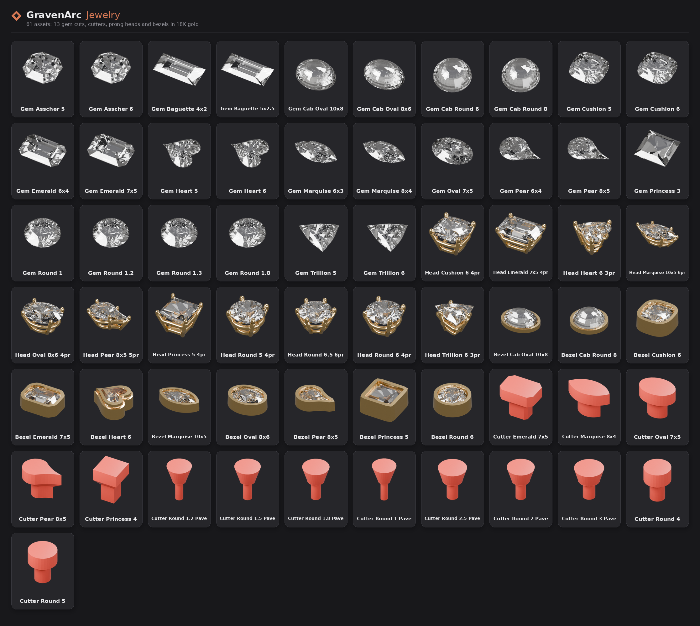

# GravenArc Jewelry Tools — ювелирные инструменты Rhino/RhinoGold в Blender 5.2 LTS

Аддон (будущая основа аддона GravenArc для extensions.blender.org, GPL-3.0) + библиотека ассетов
`GravenArc › Jewelry`. Всё в миллиметрах. Проверено в Blender 5.2.4 LTS.

## Что есть и чему соответствует в Rhino/RhinoGold

| Rhino / RhinoGold / Matrix | GravenArc (N › GravenArc) | Что делает |
|---|---|---|
| Gem Studio, Gem on Surface | **Камень** | 13 огранок: круг Кр57, овал, груша, маркиз, сердце, кушон, триллион, принцесса, изумрудная, ашер, багет, кабошоны. Ставит камень в 3D-курсор по нормали к поверхности, считает караты |
| Gem Cutter | **Вырезы под камни** | Посадка по рундисту (+зазор), конус по павильону, отверстие. Сразу Boolean в металл |
| Prong / Head Studio | **Касты → Крапаны** | Корона на 3–12 крапанах с шариками, галереи, сужение к основанию, повтор по огранке (груша — крапан на острие и т.д.) |
| Bezel | **Касты → Глухая** | Стенка по контуру любой огранки, полка-опора, литейный уклон 2° |
| Pave | **Паве** | Плотная (почти шестиугольная) укладка по любой поверхности или по выделенным граням, отступ от края, зёрна-корнеры, вырезы с раскрытием |
| Gems by Curve | **Камни по кривой** | Шаг с зазором, градуировка (от начала к концу или к центру), по нормали к поверхности, общие крапаны, вырезы |
| ArrayPolar | **Полярный массив** | Копии по кругу вокруг 3D-курсора (связанные или независимые) |
| Ring Wizard, Ring Size | **Шинка по размеру** | Любой размер RU/EU/US/UK, 5 профилей, ширина и толщина сверху/снизу, литейный уклон |
| Ring Resize | **Изменить размер кольца** | Радиальный сдвиг: ширина и толщина сохраняются, касты и камни едут вместе |
| Analyze › Ring size | **Измерить размер** | Внутренний Ø в самом узком месте во всех системах |
| Flow Along Surface, Bend | **Обернуть вокруг кольца** | Плоский орнамент/альфа-рельеф → снаружи или внутри кольца без растяжения |
| Engrave / Text on ring | **Гравировка текстом** | Вырез или рельеф внутри/снаружи кольца или на плоскости. Свой шрифт (армянский) |
| Weight / Volume | **Вес металла** | Объём с модификаторами, вес в 14 сплавах, смола в мл |
| Draft Angle Analysis, Thickness | **Проверка для литья** | Красит грани: поднутрения, малый уклон, тонкие стенки |
| Scale (shrinkage) | **Усадка** | ×1/(1−s), защита от двойного применения |
| BooleanUnion | **Слить в монолит** | Крапаны + галереи + зёрна → одна оболочка (для веса и печати) |
| Report | **Отчёт** | Таблица камней (огранка, размер, шт, ct) + металл; CSV рядом с .blend |

## Установка (шаг за шагом)

1. **Аддон.** Ювелирные инструменты входят в общий аддон **GravenArc Toolkit**: установите `gravenarc_toolkit-1.1.2.zip`
   (Edit › Preferences (**Ctrl+,**) › Get Extensions › стрелка ⌄ справа вверху › **Install from Disk…**). Подробно — `GravenArc_Addon/README_ru.md`.
2. **Ассеты.** Библиотека `GravenArc` с каталогами `GravenArc › Jewelry › …` подключится сама.
3. **Сцена.** В 3D-окне нажмите **N** → вкладка **GravenArc** → **Сцена в миллиметрах** (1 единица = 1 мм).
   Сохраните как стартовый файл: File › Defaults › Save Startup File.

## Горячие клавиши

| Клавиши | Что |
|---|---|
| **Shift+Alt+J** (Object Mode) | Пай-меню: ← Камень, → Вес, ↓ Проверка для литья, ↑ Шинка, ↖ Паве, ↗ Камни по кривой, ↙ Касты, ↘ Гравировка |
| **N** | Панель GravenArc |
| **F9** | Сразу после любой операции — поменять её параметры (размер камня, число крапанов, зазор…) |
| **Shift+A** | В конце меню Add: Камень и Шинка по размеру |
| **Shift+ПКМ** | Поставить 3D-курсор на поверхность (куда встанет камень) |
| **Shift+F1** | Asset Browser (готовые камни, вырезы, касты) |

## Рецепты

### 1. Кольцо с центральным камнем
1. **Shift+Alt+J → ↑ Шинка**. В **F9**: система RU, размер 17, профиль «Комфорт», ширина сверху 5, снизу 2,6.
   Ось кольца — Z, верх — +Y (как у шаблонов).
2. **Shift+ПКМ** по верху шинки — курсор встанет на поверхность.
3. Шинка выделена (активна) → **Shift+Alt+J → ← Камень**. В **F9**: огранка «Овал», ширина 6, длина 8,
   «Рундист над поверхностью» 1,5, «Каста: Крапаны», вырез ✓.
4. Камень выделен → панель «Камни и касты» → **Крапаны** → в **F9** число крапанов, Ø (для песка ≥ 0,7 мм), галереи.
5. Вырезать посадку: выделить камень, **Shift+клик** по шинке (она активна) → **Вырезы под камни** (Boolean ✓).

### 2. Дорожка камней по плечам
1. Нарисуйте кривую по поверхности кольца (Shift+A › Curve, или выделите цепочку рёбер и **F3 → Convert to Curve**).
2. Выделите **шинку**, затем **Shift+клик по кривой** (кривая — активная).
3. **Камни по кривой**: Ø 1,6, «Ø в центре/в конце» 1,2, градуировка «От начала к концу», зазор 0,15,
   нормаль «Выделенная поверхность», «Рундист над поверхностью» −0,32 (площадка чуть ниже металла).
4. Вырезы попадают в коллекцию **GV Cutters**. Boolean: шинка активна → «Вырезы под камни» или вручную
   Add Modifier › Boolean › Collection › GV Cutters.

### 3. Паве
1. Выделите поверхность, **Tab**, выделите грани под паве (**3** — режим граней), **Tab** обратно.
2. **Паве** (↖ в пай-меню): Ø 1,3, зазор 0,15–0,2, «Только выделенные грани» ✓. «Вариант раскладки» в **F9**
   перебирает варианты, выбирайте тот, где камней больше.
3. Зёрна (корнеры) создаются между тройками камней: Ø ≥ 0,6 мм для литья в песок.

### 4. Гравировка и орнамент на кольце
* **Гравировка текстом** → «Внутри кольца», положение 180° (низ), высота 1,4, глубина 0,3. Текст зеркалится, чтобы
  читаться изнутри. Для армянских букв в поле «Шрифт» выберите .ttf с армянским алфавитом (например, Noto Sans Armenian, Arial Unicode).
  Встроенный шрифт Blender может не содержать армянских букв.
* **Обернуть вокруг кольца**: положите плоский орнамент (например, бордюр из `alphas/`, переведённый в сетку) в плоскость XY,
  выделите его, **Shift+клик** по кольцу → оператор. Длина вдоль X сохраняется на радиусе поверхности.

### 5. Перед печатью и литьём (Delft clay)
1. **Слить в монолит** для кастов/паве (несколько пересекающихся кусков → одна оболочка).
2. **Проверка для литья**: красный — поднутрение, жёлтый — уклон < 2°, синий — стенка < 0,5 мм. Проблемные грани
   уже выделены: **Tab** — увидеть их. Вернуть обычный вид — кнопка с глазом рядом.
   Плоскость разъёма берётся из `gv_parting_z_mm` (есть у шинок и шаблонов), иначе середина по высоте.
   Режим «Одна сторона» — для моделей с плоской спинкой на разъёме.
3. **Вес металла**: объём с учётом Boolean, вес во всех сплавах, смола в мл.
4. **Усадка** 1,5–2 % (по умолчанию 1,75 → ×1,0178) — делает копию «_Print+1.75%», оригинал прячет.
5. **Отчёт** — таблица камней и металла (текст `GV_Report` в Text Editor и CSV рядом с .blend).

## Литьё в песок: что важно знать
* **Крапановые короны с галереями** почти всегда дают поднутрения в двухстворчатой форме (проверка это покажет).
  Для песка: глухая каста (она сделана с уклоном 2°), корона без галерей (`Галерей = 0`) или каста отдельно на пайку.
* **Мелкие сквозные отверстия** под камнями (Ø < 1 мм) песок держит плохо. Для литья делайте вырезы с
  «Глубина отверстия» = 0 и «Отверстие» = 0, а посадки потом сверлите/фрезеруйте по разметке.
* **Зёрна и крапаны** не тоньше 0,6–0,7 мм; оператор предупреждает, если тоньше.
* **Гравировка** мельче 0,3 мм в песке не проливается: делайте её лазером MOPA после литья.

## Ассеты (Asset Browser › GravenArc › Jewelry)
* **Gems** — 26 камней: мелочь под паве (Кр57 1,0/1,2/1,3/1,8), овал 7×5, принцесса 3, груши, маркизы, сердца, кушоны,
  триллионы, изумрудные, ашеры, багеты, кабошоны. Круглые 1,5–10, овалы и принцессы 4–6 — в Templates › Gems.
* **Cutters** — 14 вырезов: Кр57 1,0–3,0 с раскрытием 20° (паве), 4–5 мм, овал, груша, маркиз, изумрудная, принцесса.
* **Heads** — 11 крапановых каст и **Bezels** — 10 глухих: это коллекции «камень + металл + вырез».
  После перетаскивания в **F9** снимите «Instance», чтобы получить редактируемые объекты.
* Камни из ассетов понимают все инструменты (вырезы, касты, отчёт): свойства `gv_gem`, `gv_gem_L`, `gv_gem_W`.

## Файлы
* `gravenarc_jewelry/` — код аддона (`core` единицы, размеры и плотности; `gems` огранки, вырезы, касты;
  `ring` шинка, ресайз, обтекание, текст; `layout` паве и кривые; `analysis` вес и проверки; `ops`, `ui`).
* `gravenarc_jewelry/blender_manifest.toml` — позволяет собрать ювелирку и отдельным расширением, но для работы ставьте общий `gravenarc_toolkit-1.1.2.zip`.
* `build_jewelry_library.py` — пересборка ассетов, превью и демо:
  `blender -b --factory-startup --python build_jewelry_library.py` (≈1,5 мин; `-- --no-previews --no-demo` — быстрее).
* `GravenArc_Jewelry.blend`, `jewelry_preview.png`, `demo/` — результат сборки.
* Студийные превью (золото 750, бриллиант) и витрины: `../tools/render_previews.py -- jewelry` и `../tools/render_demo.py`
  (запускать после `build_jewelry_library.py`, тем же способом через `blender -b`).

## Чего пока нет (следующие шаги)
* Параметрическая правка «задним числом» (как история в Matrix): сейчас параметры меняются через **F9** только сразу после операции;
  потом — удалить и создать заново (или «Касты для камней» поверх старой: она заменяется).
* Обтекание по произвольной поверхности (сейчас — по кольцу), браслеты/цепи, замки и ушки, чертежи с размерами.
* Пресеты профилей шинок из библиотеки и кнопка «посадить шаблон под размер».
