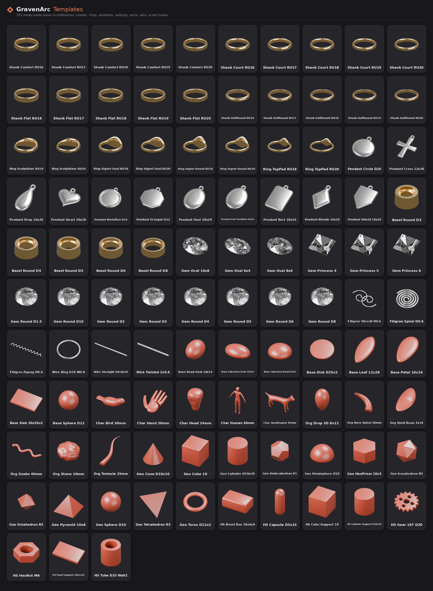

# GravenArc Templates — библиотека шаблонов для Blender 5.2 LTS

103 ассета для моделирования и лепки, всё в миллиметрах (1 единица Blender = 1 мм).



## Что внутри

| Каталог (Asset Browser) | Что лежит | Кол-во |
|---|---|---|
| Templates › Geometry | куб, сфера, цилиндр, конус, тор, полусфера, призма, пирамида, 4 правильных многогранника | 12 |
| Templates › Hard Surface | куб/пластина/цилиндр с опорными рёбрами + Subdivision, труба, капсула, шестерёнка, гайка, брусок | 8 |
| Templates › Jewelry › Shanks | шинки 4 профилей (плоская, полукруглая, комфорт, овальная) × размеры 16–20 | 20 |
| Templates › Jewelry › Rings | печатки овальная и круглая, массивная основа-перстень, шинка с площадкой; размеры 18 и 20 | 8 |
| Templates › Jewelry › Pendants | круг, овал, капля, сердце, щит, прямоугольник, ромб, восьмиугольник, крест, медальон с бортиком, двусторонний овал; у всех ушко | 11 |
| Templates › Jewelry › Settings | глухие касты для камней Ø3, 4, 5, 6, 8 | 5 |
| Templates › Jewelry › Gems | камни-болванки: круг 1,5–10 мм, овал, принцесса (для подбора каст) | 14 |
| Templates › Jewelry › Wire | проволока, кольцо из проволоки, витой жгут, скань: спираль, S-завиток, зигзаг (кривые) | 6 |
| Templates › Sculpt Bases | плитка 30×20 и диск Ø25 под рельеф/альфы, сфера, кабошоны, бусина, листок, лепесток | 8 |
| Templates › Characters | болванки: человек 60 мм, голова, кисть руки, четвероногое, птица | 5 |
| Templates › Organic | рог-спираль, щупальце, змея, камень-валун, объёмная капля, семя/ракушка | 6 |

Размер кольца: **RU-размер = внутренний диаметр в мм**. В описании каждой шинки есть EU (длина окружности) и US.

| RU (Ø, мм) | 16 | 17 | 18 | 19 | 20 |
|---|---|---|---|---|---|
| EU | 50,3 | 53,4 | 56,5 | 59,7 | 62,8 |
| US | 5,4 | 6,6 | 7,8 | 9,1 | 10,3 |

## Литьё в песок (Delft clay): что уже учтено

Это касается каталогов Shanks, Rings, Pendants, Settings и Sculpt Bases (52 шаблона). Геометрия, hard-surface, камни и персонажи сделаны точными, без литейных правок.

1. **Плоскость разъёма.** Она записана в свойстве `gv_parting_z_mm` (N › Item › Properties). У колец ось Z, разъём идёт по середине ширины шинки. У кулонов с плоской спинкой спинка лежит на Z=0. У двусторонних разъём по середине толщины.
2. **Уклоны 2°.** Все боковые стенки сходятся от разъёма, отверстия расширяются к краю. Поэтому модель выходит из формы, а внутренний Ø кольца остаётся номинальным в самом узком месте.
3. **Поднутрений нет.** Каждый шаблон проверен: 0 граней без уклона.
4. **Минимальная стенка.** Самое тонкое место среди 52 литейных шаблонов — 0,62 мм, требование ≥0,5 мм выполнено. Острые кончики (капля, сердце) скруглены R1. У каст стенка у основания толще, чтобы после уклона вверху осталось 0,6–0,7 мм.
5. **Ушки кулонов.** Отверстие Ø2 мм идёт по оси Z, вдоль съёма формы. Стержень не нужен, песок сам формирует отверстие.
6. **Усадка.** Шаблоны сделаны в **номинальном** размере. Модель для формовки увеличьте так:
   - вручную: выделить модель → **S** → набрать **1.0178** → **Enter** (это для 1,75 %; для 1,5 % — **1.0152**, для 2 % — **1.0204**);
   - или сгенерировать всю библиотеку сразу с усадкой: `-- --apply-shrink --shrink 1.75`.
   Отдельно откалибруйте усадку смолы Halot R6. Напечатайте куб 10 мм (Geometry › Geo_Cube_10), измерьте и поправьте масштаб в слайсере.

Результаты проверки по каждому шаблону лежат в `templates_report.json`: габариты, минимальная стенка, количество поднутрений.

## Установка: шаг за шагом

1. Скопируйте всю папку `GravenArc_Library` (вместе с `blender_assets.cats.txt` в корне) к себе на диск.
2. Blender → **Edit › Preferences** (Ctrl+, ) → **File Paths** → **Asset Libraries** → **+** → выберите папку `GravenArc_Library`. Имя: `GravenArc`. **Import Method: Append** (шаблон станет обычной редактируемой копией).
3. Сохраните настройки (меню ☰ в Preferences → Save Preferences).

> Файл `GravenArc_Templates.blend` собран в Blender 5.2.4 LTS и открывается в 5.2 без предупреждений. Пересобрать у себя можно одной командой (см. «Генерация заново»), это около 20 секунд.

## Как пользоваться

1. Откройте окно **Asset Browser**: в любом окне нажмите **Shift+F1** (или выберите Editor Type › Asset Browser).
2. Слева вверху выберите библиотеку **GravenArc**. Каталоги находятся в дереве слева: `GravenArc › Templates › …`.
3. Перетащите шаблон мышью в 3D-вьюпорт. Он встанет под курсор.
4. Поиск работает по тегам на русском: «шинка», «размер 18», «кулон», «каста», «Ø5», «армянский», «болванка».
5. Описание и размеры шаблона: в Asset Browser нажмите **N** (правая панель).

### Полезные клавиши при работе с шаблонами

| Действие | Клавиши |
|---|---|
| Приблизить к выделенному | **Numpad .** |
| Вид спереди / сбоку / сверху | **Numpad 1 / 3 / 7** |
| Поставить кольцо вертикально (ось Z → Y) | **R X 90 Enter** |
| Точный масштаб | **S**, число, **Enter** |
| Размеры объекта в мм | **N** → Item → Dimensions |
| Применить масштаб/поворот | **Ctrl+A** → All Transforms |
| Режим лепки | **Ctrl+Tab** → Sculpt Mode (или верхнее меню) |
| Воксельный ремеш перед лепкой | **R** — размер вокселя, **Ctrl+R** — ремеш (0,05–0,1 мм для ювелирки) |
| Dyntopo | **Ctrl+D** |
| Применить Subdivision (hard-surface) | **Ctrl+A** над модификатором → Apply |
| Проволока: редактировать форму | **Tab** (точки кривой); толщина — Properties › Data › Geometry › Bevel Depth (радиус, мм) |
| Превратить кривую в меш | Object › Convert › Mesh |

### Типичный путь: кольцо под лепку → печать → песок

1. Перетащите `Ring_SculptBase_RU18` или нужную шинку.
2. **Ctrl+Tab** → Sculpt. Нажмите **R**, задайте 0,06 мм, затем **Ctrl+R**. Лепите.
3. Посмотрите на кольцо сверху (**Numpad 7**). Всё, что вы долепили, должно расходиться от средней линии к краям (вверх и вниз), без «нависаний».
4. **S 1.0178 Enter**: компенсация усадки.
5. File › Export › STL. Units: Scene Unit, выберите только модель. Дальше слайсер Halot R6.

## Генерация заново и свои размеры

Скрипт `generate_templates.py` собирает всю библиотеку с нуля. UUID каталогов фиксированные, поэтому повторный запуск не ломает ссылки. В `blender_assets.cats.txt` скрипт дописывает только недостающие строки.

```
blender -b --factory-startup -P generate_templates.py
```

Параметры (после `--`):

| Параметр | По умолчанию | Смысл |
|---|---|---|
| `--ring-sizes 15,15.5,16,…` | 16,17,18,19,20 | размеры шинок (RU = Ø мм) |
| `--signet-sizes 17,19,21` | 18,20 | размеры печаток и колец-основ |
| `--draft 1.5` | 2 | литейный уклон, ° |
| `--apply-shrink --shrink 2` | выкл., 1,75 | увеличить литейные шаблоны на усадку |
| `--min-wall 0.6` | 0,5 | порог тонкой стенки в отчёте |
| `--only pendants,shanks` | все | собрать только часть категорий |
| `--out путь.blend` | рядом со скриптом | куда сохранить |
| `--no-previews` | — | без рендера превью (быстрее) |

Скрипт можно запустить и прямо в Blender. Откройте вкладку **Scripting**, нажмите **Open**, выберите `generate_templates.py`, затем **Alt+P**. Шаблоны появятся в текущей сцене, сохраните файл: **Ctrl+S**. Превью в этом режиме создаются так: правый клик по ассету → **Generate Preview**.

Студийные превью (золото, серебро, бриллиант, воск) и лист `preview_sheet.png` делает `../tools/render_previews.py -- templates`: `blender -b --factory-startup --python ../tools/render_previews.py -- templates`.

## Лицензия

Код: GPL-3.0-or-later. Ассеты: CC-BY-4.0, автор GravenArc. Лицензию ассетов можно сменить параметром `--license`.
