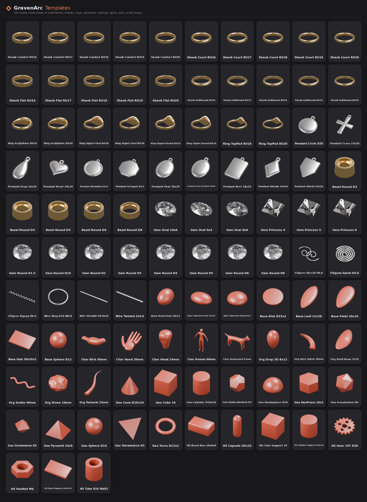

# GravenArc Templates: template library for Blender 5.2 LTS

103 assets for modelling and sculpting, all in millimetres (1 Blender unit = 1 mm).



## What is inside

| Catalog (Asset Browser) | Contents | Count |
|---|---|---|
| Templates › Geometry | cube, sphere, cylinder, cone, torus, hemisphere, prism, pyramid, 4 regular polyhedra | 12 |
| Templates › Hard Surface | cube/plate/cylinder with support edges + Subdivision, tube, capsule, gear, nut, bar | 8 |
| Templates › Jewelry › Shanks | shanks in 4 profiles (flat, half-round, comfort, court) × sizes 16–20 | 20 |
| Templates › Jewelry › Rings | oval and round signets, massive sculpting base ring, shank with a pad; sizes 18 and 20 | 8 |
| Templates › Jewelry › Pendants | circle, oval, drop, heart, shield, rectangle, rhombus, octagon, cross, rimmed medallion, two-sided oval; all with a bail | 11 |
| Templates › Jewelry › Settings | bezel cups for Ø3, 4, 5, 6, 8 stones | 5 |
| Templates › Jewelry › Gems | dummy stones: round 1.5–10 mm, oval, princess (for fitting settings) | 14 |
| Templates › Jewelry › Wire | wire, wire ring, twisted rope, filigree: spiral, S-scroll, zigzag (curves) | 6 |
| Templates › Sculpt Bases | 30×20 slab and Ø25 disc for relief/alphas, sphere, cabochons, bead, leaf, petal | 8 |
| Templates › Characters | blockouts: 60 mm human, head, hand, quadruped, bird | 5 |
| Templates › Organic | spiral horn, tentacle, snake, boulder, 3D drop, seed/shell | 6 |

Ring size: **RU size = inner diameter in mm**. Each shank's description also gives EU (circumference) and US.

| RU (Ø, mm) | 16 | 17 | 18 | 19 | 20 |
|---|---|---|---|---|---|
| EU | 50.3 | 53.4 | 56.5 | 59.7 | 62.8 |
| US | 5.4 | 6.6 | 7.8 | 9.1 | 10.3 |

For any other size, a shank with a custom profile, or resizing an existing ring, use the jewelry tools: **Шинка по размеру** (Shank by size) and **Изменить размер кольца** (Resize ring).

## Sand casting (Delft clay): what is already taken care of

This applies to the Shanks, Rings, Pendants, Settings and Sculpt Bases catalogs (52 templates). Geometry, hard-surface, gems and characters are exact, without casting adjustments.

1. **Parting plane.** It is stored in the `gv_parting_z_mm` property (N › Item › Properties). Rings have their axis along Z, and the parting runs through the middle of the shank width. Pendants with a flat back lie with the back on Z=0. Two-sided ones are parted through the middle of the thickness.
2. **2° draft.** All side walls taper away from the parting plane, holes widen towards the edge. So the model releases from the mould, and the inner ring Ø stays nominal at its narrowest point.
3. **No undercuts.** Every template was checked: 0 faces without draft.
4. **Minimum wall.** The thinnest spot among the 52 casting templates is 0.62 mm, so the ≥ 0.5 mm requirement is met. Sharp tips (drop, heart) are rounded to R1. Bezel walls are thicker at the base so that 0.6–0.7 mm remains at the top after the draft.
5. **Pendant bails.** The Ø2 mm hole runs along Z, the mould pull direction. No core is needed; the sand forms the hole itself.
6. **Shrinkage.** Templates are at **nominal** size. Enlarge the model for moulding like this:
   - by hand: select the model → **S** → type **1.0178** → **Enter** (for 1.75 %; **1.0152** for 1.5 %, **1.0204** for 2 %);
   - with the **Усадка** (Shrinkage) button of the jewelry tools;
   - or generate the whole library with shrinkage: `-- --apply-shrink --shrink 1.75`.
   Calibrate the Halot R6 resin shrinkage separately: print the 10 mm cube (Geometry › Geo_Cube_10), measure it and correct the scale in the slicer.

Per-template check results are in `templates_report.json`: dimensions, minimum wall, number of undercuts. The **Проверка для литья** (Casting check) button of the jewelry tools reads `gv_parting_z_mm` and checks your edited model the same way.

## Installation, step by step

> If you installed the **GravenArc Toolkit** add-on (`gravenarc_toolkit-1.2.0.zip`), the library is already connected: skip this section.

1. Copy the whole `GravenArc_Library` folder (with `blender_assets.cats.txt` in its root) to your disk.
2. Blender → **Edit › Preferences** (Ctrl+, ) → **File Paths** → **Asset Libraries** → **+** → choose the `GravenArc_Library` folder. Name: `GravenArc`. **Import Method: Append** (the template becomes a normal editable copy).
3. Save Preferences (☰ menu in Preferences → Save Preferences).

> `GravenArc_Templates.blend` was built in Blender 5.3. If Blender 5.2 warns about a newer version, rebuild the library yourself with one command (see "Regenerating"). It takes about 20 seconds.

## How to use

1. Open the **Asset Browser**: in any area press **Shift+F1** (or choose Editor Type › Asset Browser).
2. At the top left pick the **GravenArc** library. The catalogs are in the tree on the left: `GravenArc › Templates › …`.
3. Drag a template into the 3D Viewport. It lands under the cursor.
4. Search works with Russian tags: «шинка» (shank), «размер 18» (size 18), «кулон» (pendant), «каста» (setting), «Ø5», «армянский» (Armenian), «болванка» (blank).
5. Template description and dimensions: press **N** in the Asset Browser (right panel).

### Useful keys when working with templates

| Action | Keys |
|---|---|
| Zoom to selected | **Numpad .** |
| Front / side / top view | **Numpad 1 / 3 / 7** |
| Stand a ring upright (Z axis → Y) | **R X 90 Enter** |
| Exact scale | **S**, number, **Enter** |
| Object dimensions in mm | **N** → Item → Dimensions |
| Apply scale/rotation | **Ctrl+A** → All Transforms |
| Sculpt mode | **Ctrl+Tab** → Sculpt Mode (or the top menu) |
| Voxel remesh before sculpting | **R** for voxel size, **Ctrl+R** to remesh (0.05–0.1 mm for jewelry) |
| Dyntopo | **Ctrl+D** |
| Apply Subdivision (hard-surface) | **Ctrl+A** over the modifier → Apply |
| Wire: edit the shape | **Tab** (curve points); thickness: Properties › Data › Geometry › Bevel Depth (radius, mm) |
| Turn a curve into a mesh | Object › Convert › Mesh |

### Typical path: sculpting ring → print → sand

1. Drag in `Ring_SculptBase_RU18` or the shank you need.
2. **Ctrl+Tab** → Sculpt. Press **R**, set 0.06 mm, then **Ctrl+R**. Sculpt.
3. Look at the ring from the top (**Numpad 7**). Everything you added must spread from the centre line towards the edges (up and down), without overhangs. Or run **Проверка для литья** (Casting check).
4. **S 1.0178 Enter**: shrinkage compensation.
5. File › Export › STL. Units: Scene Unit, select only the model. Then the Halot R6 slicer.

## Regenerating and custom sizes

The `generate_templates.py` script builds the whole library from scratch. Catalog UUIDs are fixed, so rerunning it does not break references. The script only appends missing lines to `blender_assets.cats.txt`.

```
blender -b --factory-startup -P generate_templates.py
```

Parameters (after `--`):

| Parameter | Default | Meaning |
|---|---|---|
| `--ring-sizes 15,15.5,16,…` | 16,17,18,19,20 | shank sizes (RU = Ø mm) |
| `--signet-sizes 17,19,21` | 18,20 | sizes of signets and base rings |
| `--draft 1.5` | 2 | casting draft, ° |
| `--apply-shrink --shrink 2` | off, 1.75 | enlarge casting templates by the shrinkage |
| `--min-wall 0.6` | 0.5 | thin wall threshold in the report |
| `--only pendants,shanks` | all | build only some categories |
| `--out path.blend` | next to the script | where to save |
| `--no-previews` | — | skip preview rendering (faster) |

You can also run the script inside Blender. Open the **Scripting** tab, press **Open**, choose `generate_templates.py`, then **Alt+P**. The templates appear in the current scene; save the file with **Ctrl+S**. In this mode previews are made like this: right-click an asset → **Generate Preview**.

Studio previews (gold, silver, diamond, wax) and the `preview_sheet.png` sheet come from `../tools/render_previews.py -- templates`: `blender -b --factory-startup --python ../tools/render_previews.py -- templates`.

## License

Code: GPL-3.0-or-later. Assets: CC-BY-4.0, author GravenArc. The asset license can be changed with the `--license` parameter.
