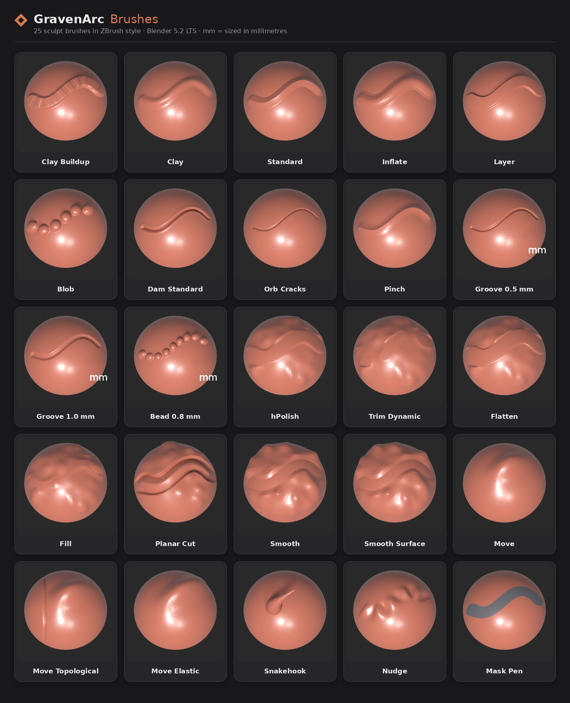
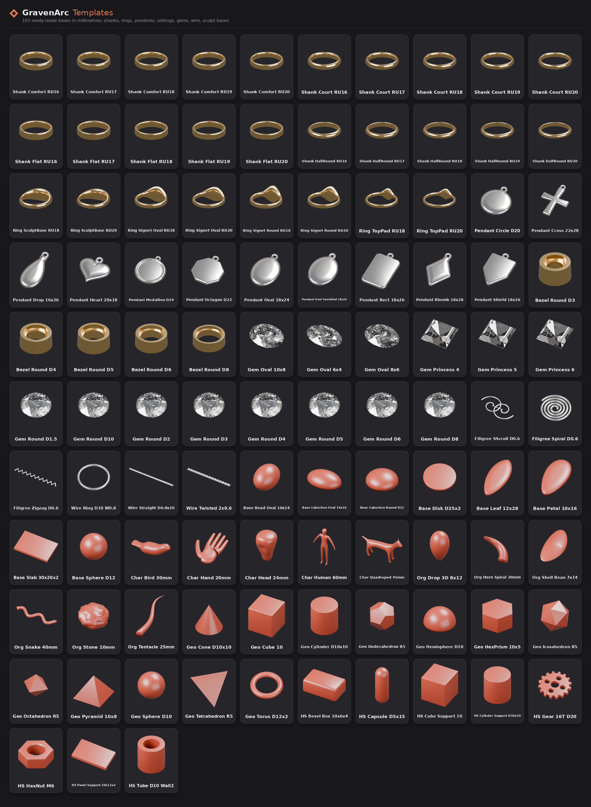
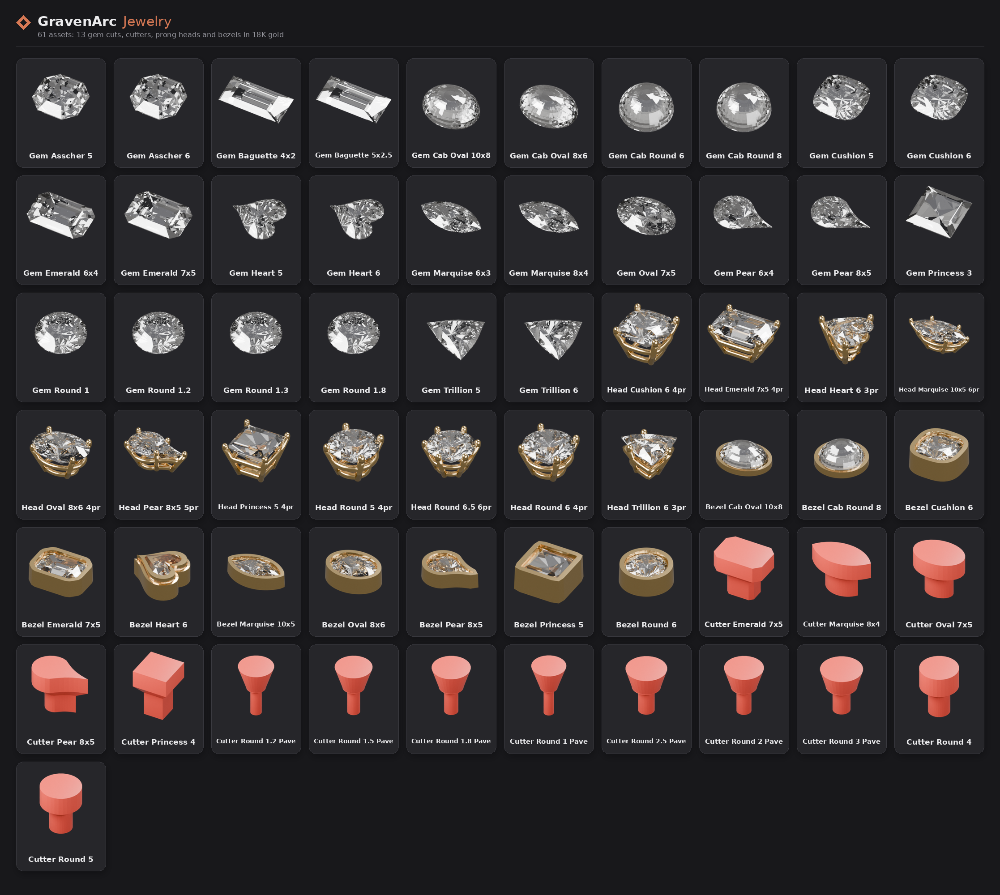
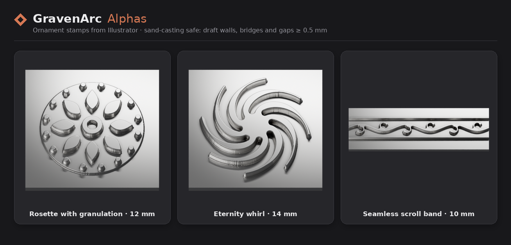

# GravenArc Toolkit for Blender

**Free jewelry toolkit for Blender 5.2 LTS: RhinoGold-style jewelry tools, ZBrush-style brushes, ornament alphas and 103 templates. Everything in millimetres, ready for resin printing and sand casting.**

[**⬇ Download the latest release**](https://github.com/Gravenarc/gravenarc-toolkit/raw/main/download/gravenarc_toolkit-1.1.6.zip) · [Русская версия](README_ru.md) · Instagram [@gravenarc](https://instagram.com/gravenarc)

## What's inside

| | |
|---|---|
| 💎 **Jewelry tools** (RhinoGold / Matrix style) | Gems in 13 cuts with carat weight · prong heads and bezels · gem cutters · one-click pavé · gems along a curve · polar array · shank in any ring size (RU/EU/US/UK) · ring resize and size measurement · wrap ornament around a ring · text engraving inside/outside the ring · metal weight in 14 alloys · casting check (undercuts, draft, thin walls) · shrinkage · merge to one solid · gem & metal report (CSV) |
| 🖌 **25 brushes** | ZBrush-style presets: Clay Buildup, Dam Standard, hPolish, Trim Dynamic, Orb Cracks, Move Topological… plus Groove 0.5/1.0 mm and Bead 0.8 mm sized in real millimetres |
| 🌀 **Ornament alphas** | Rosette with granulation, Armenian eternity whirl, seamless scroll band. Converter from Illustrator SVG with checks for sand casting (bridges and gaps ≥ 0.5 mm) |
| 📦 **103 templates + 61 jewelry assets** | Shanks, rings, signets, pendants, settings, gems, wire and filigree, sculpting bases, geometry |

Hotkeys: **N › GravenArc** panel, pie menu **Shift+Alt+J** (Object Mode), **Shift+A** › Gem / Shank by size, **F9** to tweak the last operation.

## Install

1. Download [`gravenarc_toolkit-1.1.6.zip`](https://github.com/Gravenarc/gravenarc-toolkit/raw/main/download/gravenarc_toolkit-1.1.6.zip). Do not unzip it.
2. Drag the zip into the Blender 5.2 window, or **Edit › Preferences › Get Extensions › ⌄ › Install from Disk…**
3. Press **N** in the 3D Viewport → **GravenArc** tab → **Scene in millimetres**.

The **GravenArc** asset library connects itself (Asset Browser, **Shift+F1**). Step-by-step guides: [GravenArc_Addon/README_en.md](GravenArc_Addon/README_en.md), [jewelry tools](GravenArc_Library/jewelry_tools/README_en.md), [brushes](GravenArc_Library/brushes/README_en.md), [alphas](GravenArc_Library/alphas/README_en.md), [templates](GravenArc_Library/templates/README_en.md).

> The add-on interface is currently in Russian; the English guides give every button with a translation. An English UI is planned.

## Feedback welcome

This is the first public version. Jewelry designers especially: tell us what to change, add or keep. Open an [issue](../../issues) or write on Instagram [@gravenarc](https://instagram.com/gravenarc).

## About

Made by **David K. Khachatryan (GravenArc)**, a jeweler and laser engraver, together with **Claude**, an AI assistant by Anthropic.

## Build from source

`GravenArc_Addon/build_addon.sh` packs `GravenArc_Addon/src` and `GravenArc_Library` into the extension zip (needs Blender 5.2+). Asset libraries and previews are rebuilt by the scripts in `GravenArc_Library/` (see the READMEs there).

## License

GPL-3.0-or-later, see [LICENSE](LICENSE).
