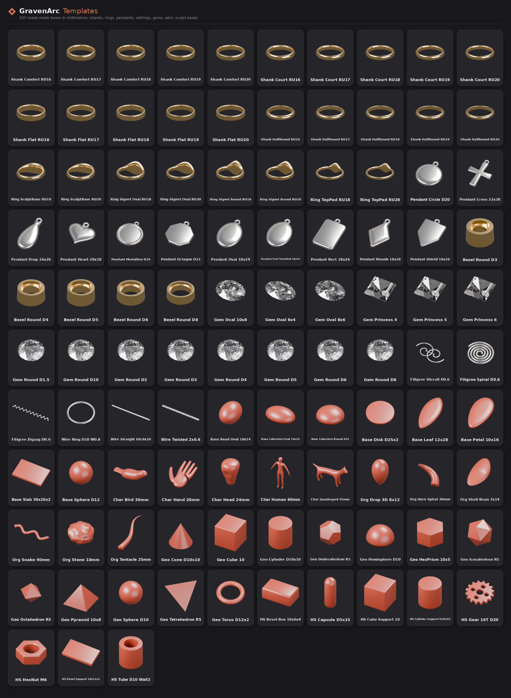
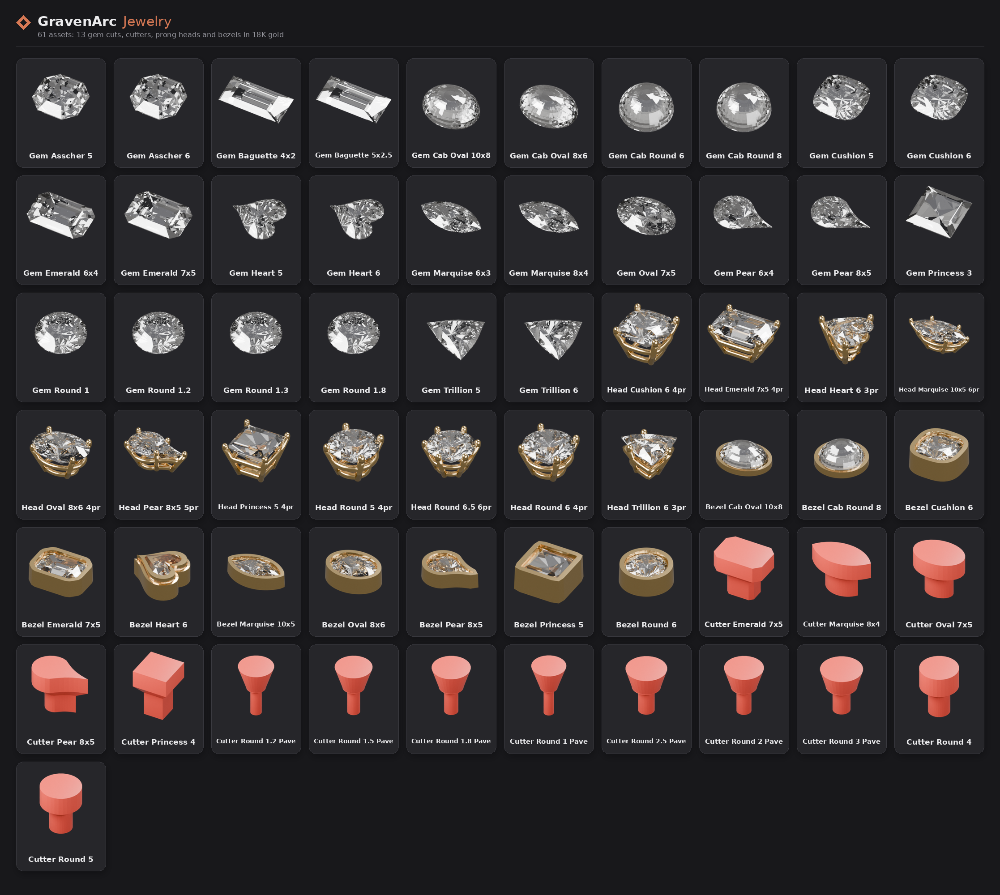
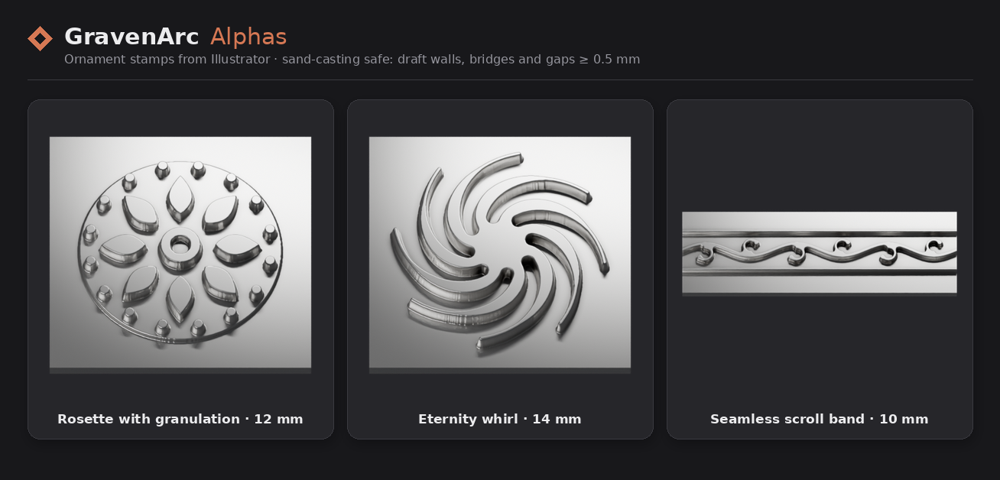

# GravenArc Toolkit для Blender

**Бесплатный ювелирный набор для Blender 5.2 LTS: инструменты в духе RhinoGold, кисти в стиле ZBrush, альфы-орнаменты и 103 шаблона. Всё в миллиметрах, готово к печати смолой и литью в песок.**

[**⬇ Скачать последнюю версию**](https://github.com/Gravenarc/gravenarc-toolkit/raw/main/download/gravenarc_toolkit-1.2.0.zip) · [English](README.md) · Instagram [@gravenarc](https://instagram.com/gravenarc)

## Что внутри

| | |
|---|---|
| 💎 **Ювелирные инструменты** (как в RhinoGold / Matrix) | Камни 13 огранок с расчётом карат · крапановые и глухие касты · вырезы под камни · паве в один клик · камни по кривой · полярный массив · шинка любого размера (RU/EU/US/UK) · ресайз и замер размера · обтекание орнамента вокруг кольца · гравировка текстом · вес металла в 14 сплавах · проверка для литья (поднутрения, уклон, тонкие стенки) · усадка · слить в монолит · отчёт по камням и металлу (CSV) |
| 🖌 **25 кистей** | Пресеты в стиле ZBrush: Clay Buildup, Dam Standard, hPolish, Trim Dynamic, Orb Cracks, Move Topological… и Groove 0,5/1,0 мм, Bead 0,8 мм в реальных миллиметрах |
| 🌀 **Альфы-орнаменты** | Розетка с зернью, армянский вихрь вечности, бесшовный бордюр. Конвертер из SVG Illustrator с проверкой под литьё в песок (перемычки и щели ≥ 0,5 мм) |
| 🔁 **Повтор мазка и кисть как в Photoshop** (новое в 1.2.0) | Shift+R — повторить/заменить последний мазок текущей кистью, сила повтора и «живая» сила мышью · Alt+R — маска на последний мазок · метка и маска «всё, что изменилось после неё» · запомнить/вернуть маску · отделить/удалить замаскированное и скрытое · Alt+ПКМ — размер и жёсткость кисти с кругом-превью · Alt+L — прямая линия · папки пресетов кистей · сглаживание мазка. [Инструкция](GravenArc_Library/sculpt_tools/README_ru.md) |
| 📦 **103 шаблона + 61 ювелирный ассет** | Шинки, кольца, печатки, кулоны, касты, камни, проволока и скань, основы для лепки, геометрия |

Горячие клавиши: панель **N › GravenArc**, пай-меню **Shift+Alt+J** (Object Mode), **Shift+A** › Камень / Шинка по размеру, **F9** — поменять параметры последней операции.

## Установка

1. Скачайте [`gravenarc_toolkit-1.2.0.zip`](https://github.com/Gravenarc/gravenarc-toolkit/raw/main/download/gravenarc_toolkit-1.2.0.zip). Распаковывать не нужно.
2. Перетащите zip в окно Blender 5.2 или **Edit › Preferences › Get Extensions › ⌄ › Install from Disk…**
3. В 3D-окне **N** → вкладка **GravenArc** → **Сцена в миллиметрах**.

Библиотека ассетов **GravenArc** подключится сама (Asset Browser, **Shift+F1**). Подробные инструкции: [GravenArc_Addon/README_ru.md](GravenArc_Addon/README_ru.md), [ювелирка](GravenArc_Library/jewelry_tools/README_ru.md), [кисти](GravenArc_Library/brushes/README_ru.md), [альфы](GravenArc_Library/alphas/README.md), [шаблоны](GravenArc_Library/templates/README.md).

## Ждём ваших отзывов

Это первая публичная версия. Особенно просим ювелирных дизайнеров: напишите, что поменять, добавить или оставить. Создайте [issue](../../issues) или пишите в Instagram [@gravenarc](https://instagram.com/gravenarc).

## Авторы

**David K. Khachatryan (GravenArc)**, ювелир и лазерный гравёр, вместе с **Claude**, ИИ-ассистентом от Anthropic.

## Лицензия

GPL-3.0-or-later, см. [LICENSE](LICENSE).
